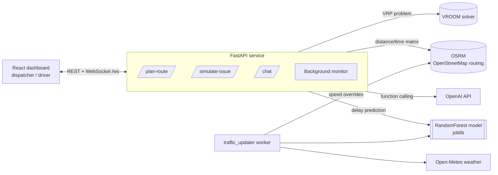

# smart_logistics

> Containerized, real-time fleet routing backend that combines a road-network routing engine (OSRM), a VRP solver (VROOM) and an ML delay predictor, with WebSocket push updates and an LLM-assisted dispatcher.


Built as a hackathon project. The demo scenario is the city of Sivas (Türkiye), and the engine itself is not tied to any paid mapping API.

---

## Architecture Overview

The system is a small **service-oriented topology** orchestrated by Docker Compose. The API acts as a domain orchestrator: it does not solve routing itself, it composes specialized engines.



**Request flow for `POST /plan-route`:**
1. Build a travel time/distance matrix from OSRM.
2. Apply the ML model (`distance_km, hour, is_rain, traffic_score → delay_minutes`) to adjust expected travel times.
3. Submit the adjusted matrix to VROOM to solve the multi-vehicle routing problem (VRP).
4. Resolve unassigned jobs, build route geometry, and broadcast the new plan to every connected courier over WebSocket.

`POST /simulate-issue` re-plans the fleet when a road incident is injected (rain / traffic score) and reports the delay versus the original plan.

---

## Key Features

- **Composable routing stack.** OSRM provides real road-network matrices, VROOM solves the VRP; the API stitches them together with an ML correction layer instead of reinventing either.
- **Graceful degradation.** The OSRM client uses short explicit timeouts and falls back to straight-line geometry when the routing engine is unavailable; the chat endpoint has a fallback path when the LLM call fails.
- **Real-time delivery.** A WebSocket `ConnectionManager` pushes replanned routes to all connected clients; a background task periodically re-evaluates conditions and broadcasts `AUTO_UPDATE` events.
- **Predictive delay model.** A scikit-learn `RandomForestRegressor` (`train.py`, 80/20 split, MAE reported) estimates delay from distance, hour, rain and traffic, loaded once at startup via `joblib`.
- **LLM function calling.** The dispatcher chat can trigger tools such as incident simulation and fleet replanning, and the system generates human-readable dispatcher advice for route changes.
- **One-command deployment.** `docker-compose.yml` defines the VROOM, OSRM, API and frontend services; `deploy.sh` and `setup_osrm.sh` prepare Docker, `.env` and OSRM map data.

---

## Tech Stack & Rationale

| Technology | Why it was chosen |
| :-- | :-- |
| **FastAPI** | Async-first framework with typed Pydantic request models, native WebSocket support and auto-generated OpenAPI docs at `/docs`. |
| **OSRM** | Self-hosted, open-source routing on OpenStreetMap data: no per-request pricing and no vendor lock-in. |
| **VROOM** | Purpose-built open-source solver for vehicle routing problems; far more capable than a naive nearest-neighbor heuristic. |
| **scikit-learn RandomForest + joblib** | Robust tabular regressor with little tuning, cheap inference and simple model persistence. |
| **OpenAI API (function calling)** | Lets natural-language dispatcher requests trigger real backend actions. |
| **Open-Meteo** | Free weather API that needs no key, used for rain detection. |
| **Docker Compose** | Reproducible multi-service environment with `restart: unless-stopped` policies. |
| **React + Vite + Tailwind** | Fast dashboard for the dispatcher and driver views. |

---

## Getting Started

```bash
git clone https://github.com/NURJAKS/smart_logistics.git
cd smart_logistics
echo "OPENAI_API_KEY=your_key" > .env
./deploy.sh          # checks Docker, prepares OSRM data, starts the stack
```

| Service | Port |
| :-- | :-- |
| FastAPI | `18000` (docs at `/docs`) |
| VROOM | `13001` |
| OSRM | `5000` |

Train the model locally with `python data_gen.py && python train.py`.

### API

| Method | Endpoint | Purpose |
| :-- | :-- | :-- |
| `POST` | `/plan-route` | Optimize routes for a set of points and vehicles |
| `POST` | `/simulate-issue` | Replan after a simulated rain/traffic incident |
| `POST` | `/chat` | LLM-assisted dispatcher with tool calling |
| `GET` | `/health` | Status of dependent systems |
| `WS` | `/ws` | Live route updates |

---

## Known Limitations & Roadmap

This is a hackathon-stage codebase, and these are the next engineering steps:

- Remove the `docker.sock` mount and the `os.system` call used to refresh OSRM traffic data, replacing them with a dedicated worker or API.
- Split the 680-line `main.py` into routers/services and add automated tests.
- Replace the hard-coded demo scenario (locations and incident parameters in the background monitor) with real inputs.
- Use async HTTP clients throughout the planning path.
